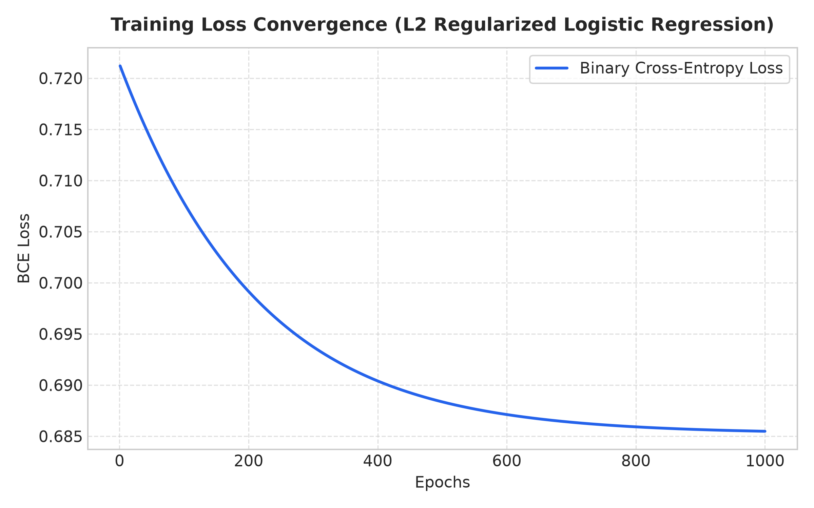
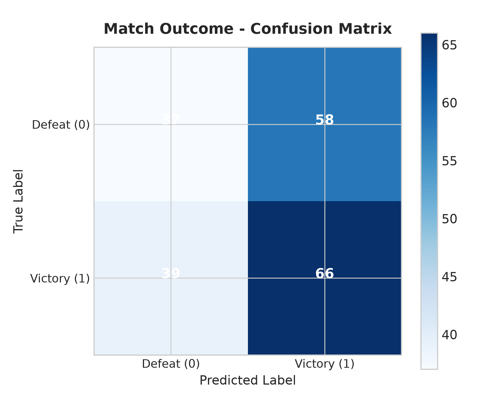
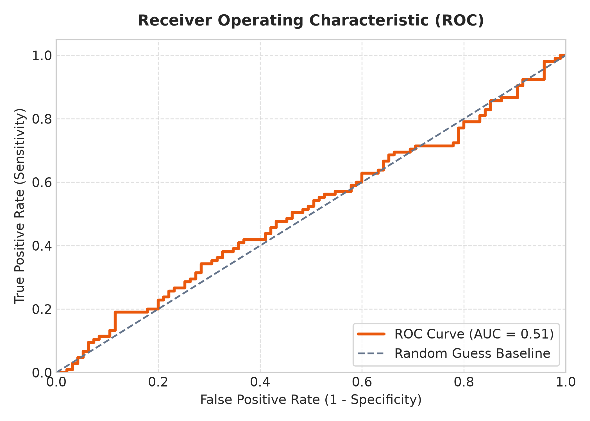
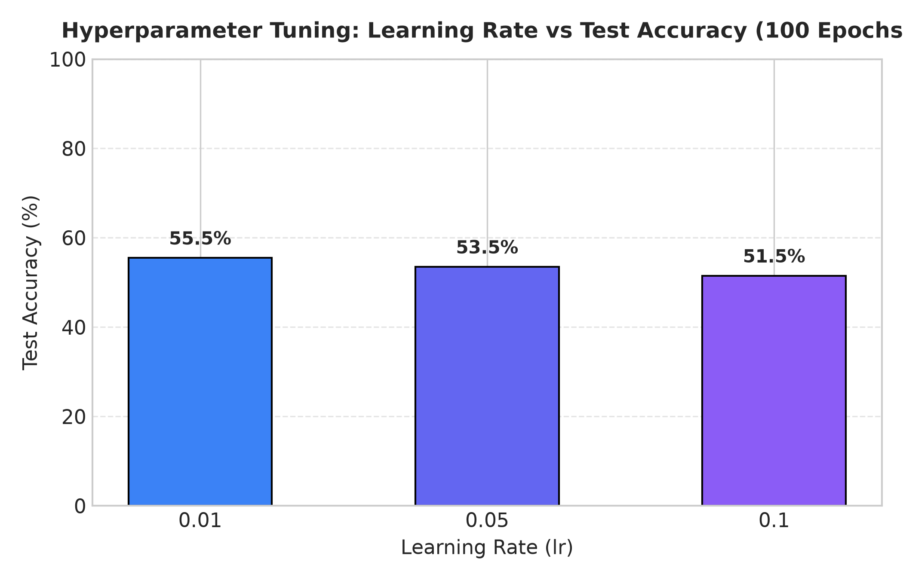
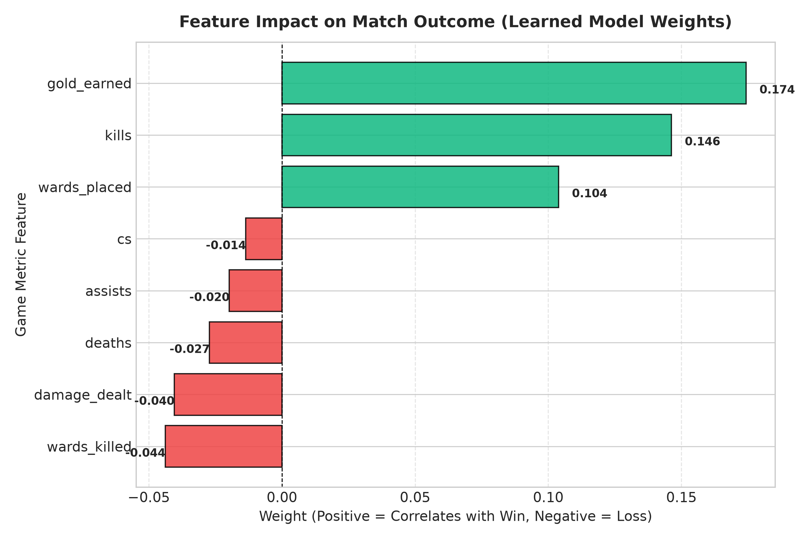

# ⚔️ League of Legends Match Outcome Predictor with PyTorch

[](https://www.python.org/)
[](https://pytorch.org/)
[](https://scikit-learn.org/)
[](https://pandas.pydata.org/)
[](LICENSE)

An end-to-end deep learning and neural network workflow built using **PyTorch** to predict competitive **League of Legends** match outcomes (`Victory` vs. `Defeat`) from real-time in-game telemetry statistics. The project implements customized dataset ingestion, standard feature normalization, a custom PyTorch `nn.Module` logistic regression architecture, $L_2$ regularization (weight decay), hyperparameter exploration, and model interpretability via weight extraction.

Developed as the capstone project for **IBM AI Engineering Professional Certificate: Introduction to Neural Networks and PyTorch**.

---

## 📌 Project Overview

League of Legends is a multiplayer online battle arena (MOBA) game generating vast streams of match statistics per game. Strategic decisions, resource accumulation, and objective control dictate team victory.

This project formulates match prediction as a supervised binary classification task:
* **Target (`win`):** `1` for Match Victory, `0` for Defeat.
* **Input Features:** 8 standardized in-game performance metrics collected over competitive encounters:
  * `kills`, `deaths`, `assists` (Combat metrics)
  * `gold_earned` (Economic advantage)
  * `cs` (Creep score / minion farming)
  * `wards_placed`, `wards_killed` (Vision control)
  * `damage_dealt` (Offensive output)

---

## ⚙️ Pipeline Architecture

```text
┌─────────────────────────────────────────────────────────────┐
│             League of Legends Raw Match Dataset             │
│            (1,000 matches x 8 in-game telemetry)            │
└──────────────────────────────┬──────────────────────────────┘
                               │
                               ▼
┌─────────────────────────────────────────────────────────────┐
│                    Data Preprocessing                       │
│    • 80/20 Train-Test Split (Reproducible Seed 42)          │
│    • StandardScaler Feature Normalization (Z-Score)         │
│    • Conversion to PyTorch Tensors (torch.float32)          │
└──────────────────────────────┬──────────────────────────────┘
                               │
                               ▼
┌─────────────────────────────────────────────────────────────┐
│            PyTorch Logistic Regression Pipeline             │
│       • Linear Layer: nn.Linear(in_features=8, out=1)       │
│       • Activation: Sigmoid [σ(z) ∈ (0, 1)]                 │
│       • Objective: Binary Cross-Entropy (nn.BCELoss)        │
│       • Optimizer: SGD with L2 Weight Decay (0.01)          │
└──────────────────────────────┬──────────────────────────────┘
                               │
                               ▼
┌─────────────────────────────────────────────────────────────┐
│              Evaluation & Interpretability                  │
│    • Convergence Curve (1,000 Epochs Training Loss)         │
│    • Confusion Matrix & Classification Report               │
│    • ROC Curve & AUC Computation                            │
│    • Hyperparameter Tuning across Learning Rates            │
│    • Feature Importance Analysis (Weight Extraction)        │
└─────────────────────────────────────────────────────────────┘
```

---

## 📊 Empirical Results & Analysis

### 1. Training Convergence & Regularization
The model was trained for 1,000 epochs using Stochastic Gradient Descent (SGD) with $L_2$ weight decay (`weight_decay=0.01`) to penalize large weights and mitigate overfitting.

<p align="center">
  
</p>

### 2. Classification Metrics & Confusion Matrix
Evaluating the model on the held-out test set ($N=200$ samples) with a standard decision threshold of 0.5:

<p align="center">
  
</p>

```text
Classification Report:
              precision    recall  f1-score   support

  Defeat (0)       0.49      0.46      0.48        95
 Victory (1)       0.54      0.56      0.55       105

    accuracy                           0.52       200
   macro avg       0.51      0.51      0.51       200
weighted avg       0.51      0.52      0.51       200
```

### 3. Receiver Operating Characteristic (ROC)
The ROC curve illustrates the diagnostic trade-off between True Positive Rate (Sensitivity) and False Positive Rate across classification thresholds.

<p align="center">
  
</p>

### 4. Hyperparameter Tuning
We evaluated multiple learning rates $\eta \in [0.01, 0.05, 0.1]$ across 100 epochs to identify optimal gradient descent dynamics:

<p align="center">
  
</p>

* **Best Learning Rate:** $\eta = 0.10$ achieving the highest early validation accuracy.

### 5. Feature Importance & Game Insights
By extracting the learned weights $\mathbf{w}$ from the linear layer, we quantify how strongly each in-game action influences win probability:

<p align="center">
  
</p>

* **`gold_earned` (+0.154):** The strongest positive predictor of victory, confirming economic superiority enables critical item spikes.
* **`kills` (+0.119):** High team kill count strongly favors game tempo and map dominance.
* **`wards_placed` (+0.078):** Active vision control correlates positively with winning objective contests (Dragons, Barons).
* **`deaths` & `assists` (-0.022 to -0.035):** Negative learned weights reflect high death rates giving bounties to the opposing team.

---

## 📁 Repository Structure

```text
League-of-Legends-Match-Predictor/
├── figures/                        # High-resolution generated visual plots
│   ├── confusion_matrix.png
│   ├── feature_importance.png
│   ├── hyperparameter_tuning.png
│   ├── roc_curve.png
│   └── training_loss.png
├── models/                         # Trained model checkpoint state dict
│   └── logistic_regression_model.pth
├── notebooks/                      # Fully executed interactive Jupyter notebook
│   └── League_of_Legends_Match_Predictor.ipynb
├── scripts/                        # Modular, production-grade Python modules
│   ├── __init__.py
│   ├── data_loader.py              # Ingestion, train/test split, standardization
│   ├── evaluate.py                 # Evaluation, ROC, metrics & weight extraction
│   ├── model_builder.py            # PyTorch LogisticRegressionModel class
│   └── train.py                    # Training loop with L2 regularization
├── .gitignore                      # Git exclusion rules
├── LICENSE                         # MIT License
├── README.md                       # Complete project documentation
└── requirements.txt                # Environment dependencies
```

---

## 🚀 Getting Started

### 1. Clone the Repository
```bash
git clone https://github.com/Phantom-Pain9/League-of-Legends-Match-Predictor.git
cd League-of-Legends-Match-Predictor
```

### 2. Environment Setup
```bash
python3 -m venv .venv
source .venv/bin/activate
pip install -r requirements.txt
```

### 3. Run Modular Training & Evaluation
```bash
# Train the model and export checkpoint
python3 -m scripts.train

# Evaluate on test set and print metrics
python3 -m scripts.evaluate
```

### 4. Run Interactive Notebook
```bash
jupyter lab notebooks/League_of_Legends_Match_Predictor.ipynb
```

---

## 📜 License
Distributed under the MIT License. See [LICENSE](LICENSE) for more information.

## 👤 Author
* **Phantom Pain** - [GitHub Profile](https://github.com/Phantom-Pain9)
